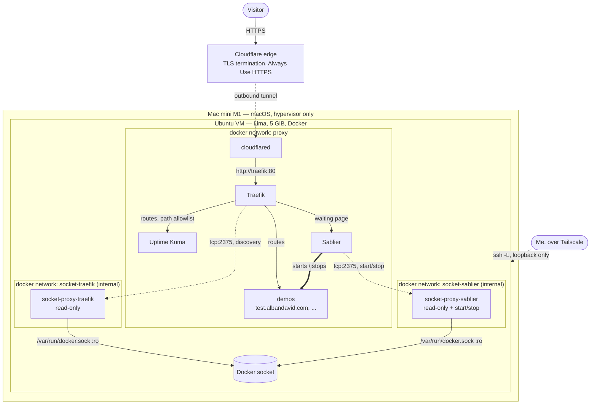

# infra

Public-facing base layer for my homelab. It serves the demos of my portfolio,
one per subdomain of `albandavid.com`.

Nothing is opened on the home router. The public reaches the demos through a
Cloudflare Tunnel, which is an **outbound** connection; administration goes
through Tailscale. Idle demos are shut down automatically and woken up on the
first visit, so a 5 GiB VM can host more demos than it could keep running.

## Architecture



A request to a sleeping demo: Cloudflare → cloudflared → Traefik → the Sablier
middleware intercepts it → Sablier starts the container → the visitor gets a
self-refreshing waiting page → once the container answers, the request is
proxied through. After the inactivity window with no traffic, Sablier stops it
again.

## Services

Every image is pinned to an exact version. Nothing uses `latest`.

| Service | Image | Role |
|---|---|---|
| `cloudflared` | `cloudflare/cloudflared:2026.10.7` | Outbound tunnel to Cloudflare. The only path in from the internet. |
| `traefik` | `traefik:v3.7.18` | Reverse proxy. Routes each hostname to a demo, applies middlewares. |
| `sablier` | `sablierapp/sablier:1.18.0` | Starts demos on demand, stops them after inactivity. |
| `uptime-kuma` | `louislam/uptime-kuma:2.5.9` | Monitoring. Only its status page is public. |
| `socket-proxy-traefik` | `lscr.io/linuxserver/socket-proxy:3.4.7-r0-ls104` | Read-only window onto the Docker API, for Traefik's discovery. |
| `socket-proxy-sablier` | `lscr.io/linuxserver/socket-proxy:3.4.7-r0-ls104` | Same, plus start/stop, for Sablier. |
| `whoami` (demo) | `traefik/whoami:v1.12.0` | Test demo, in `examples/whoami/`. |

The Traefik Sablier middleware is the plugin `github.com/sablierapp/sablier-traefik-plugin`
at `v1.4.0`, declared in `traefik/traefik.yml` and loaded at runtime.

Uptime Kuma note: upstream still points the `latest` Docker tag at the 1.x
line, to avoid dragging existing users across a breaking major. 2.5.9 is a
regular, non-prerelease 2.x release and this is a fresh install, so it is
pinned to 2.5.9.

### Memory budget

Roughly 4 GiB is reserved for the demos; this base layer is meant to fit in
0.6–0.8 GiB. Every service declares a `mem_limit`:

| Service | `mem_limit` |
|---|---|
| `traefik` | 128 MiB |
| `uptime-kuma` | 320 MiB |
| `sablier` | 96 MiB |
| `cloudflared` | 64 MiB |
| each socket proxy | 32 MiB |

Those are ceilings, not reservations; actual usage is well below the total.
Check it with `docker stats --no-stream`.

## Security choices

**Two socket proxies, not one.** Handing `/var/run/docker.sock` to a container
is handing it root on the host. Only the two proxies mount the socket, and they
mount it read-only, each on its own `internal` Docker network with no route to
the internet. Traefik and Sablier reach the Docker API over TCP through their
own proxy and nothing else. The split matters because the two need different
rights: Traefik only needs to read, so its proxy is strictly read-only
(`POST=0`); Sablier also needs to start and stop containers.

**Sablier's proxy stays read-only too, on purpose.** Sablier's documentation
asks for `POST=1`, because after stopping a container Sablier calls
`POST /containers/{id}/wait` to confirm the stop and the proxy has no
`ALLOW_WAIT` flag for that one call. This stack refuses `POST=1` anyway:
measured on this host, `CONTAINERS=1` + `POST=1` also lets
`POST /containers/{id}/exec` through — HTTP 201, despite `EXEC=0`, because the
`CONTAINERS` rule matches first. A compromised Sablier would then get command
execution inside every container on the host, which is exactly what the proxy
is supposed to prevent. `ALLOW_START` / `ALLOW_STOP` work even with `POST=0`,
so stopping and starting still works.

The price is cosmetic log noise. **Expect two lines like this in Sablier's log
on every shutdown — they are normal here:**

```
ERR docker/container_stop.go:82 cannot wait for container to stop ... 403 Forbidden
ERR sablier/instance_expired.go:48 instance expired could not be stopped from provider ... 403 Forbidden
```

The container *is* stopped; only the follow-up confirmation is refused. Two
consecutive wake/serve/auto-stop cycles were verified in this state.

**No published ports for public traffic.** The tunnel is outbound, so Traefik
needs no host port at all: `cloudflared` talks to `traefik:80` over the `proxy`
network. The only published ports are bound to `127.0.0.1` of the VM, for
administration over an SSH tunnel:

| What | VM loopback | How to reach it |
|---|---|---|
| Traefik dashboard / API | `127.0.0.1:8080` | `ssh -L 8080:127.0.0.1:8080 homelab-vm` |
| Uptime Kuma admin | `127.0.0.1:3001` | `ssh -L 3001:127.0.0.1:3001 homelab-vm` |

Verify with `docker ps --format '{{.Names}}\t{{.Ports}}'`: nothing should be on
`0.0.0.0`. Note that published Docker ports bypass `ufw`, so binding to the
loopback — not a firewall rule — is what keeps these private.

The Traefik dashboard runs with `api.insecure: true`, i.e. without
authentication. It is on its own entrypoint, never on `web`, so it is
unreachable from the internet. Residual exposure, accepted: another container
on the `proxy` network could read it. Traefik's API is read-only, so that
discloses configuration but changes nothing. Set `api: false` in
`traefik/traefik.yml` if you would rather not have it at all.

**Real visitor IPs, not spoofable.** Traffic always arrives from `cloudflared`,
so the `web` entrypoint trusts `X-Forwarded-*` only from the `proxy` subnet
(`forwardedHeaders.trustedIPs`). That subnet is `172.18.0.0/16` today and the
value in `traefik/traefik.yml` must match it — see the rebuild procedure below,
which pins it. Both entrypoints also set `aliasHeadersStrategy: delete`:
without it, a visitor could bypass the restriction by sending
`X_Forwarded_For`, which Go treats as a different header but a CGI/PHP/nginx
backend reads as the same variable.

**Uptime Kuma is public only as a status page.** Uptime Kuma serves its whole
SPA from a catch-all Express route, so a host-only rule would publish the admin
UI. The public router is therefore a path allowlist, built from the 2.5.9
source rather than guessed — `server/routers/status-page-router.js` for the
status routes and the static mounts in `server/server.js` for the assets:

- allowed: `/status`, `/status-page`, `/status/*`, `/api/status-page/*`,
  `/assets/*`, `/upload/*`, and the icons from `public/`
  (`/favicon.ico`, `/icon.svg`, `/icon.png`, `/icon-192x192.png`,
  `/icon-512x512.png`, `/apple-touch-icon.png`, `/manifest.json`,
  `/robots.txt`);
- refused, so Traefik answers 404: `/`, `/dashboard`, `/setup`, `/metrics`,
  everything under `/api/` that is not `status-page`, and **`/socket.io/*`**.

That last one carries the weight: Uptime Kuma's admin UI *and its login* both
run over socket.io. With it blocked, authentication cannot even be attempted
from the internet, so the admin UI is unusable there even though the SPA shell
could load.

**Reusable security headers.** `traefik/dynamic/middlewares.yml` defines
`security-headers@file`: `X-Frame-Options: DENY`, `nosniff`, a one-year HSTS
(`forceSTSHeader` is required because Traefik only ever sees plain HTTP behind
cloudflared), a strict `Referrer-Policy`, a closed `Permissions-Policy`, and no
`Server` / `X-Powered-By`. `stsIncludeSubdomains` is deliberately off: each
demo is a leaf hostname, so it would buy nothing and commit their subdomains
for a year.

## Adding a demo

A demo is its own Compose project, in its own directory, on the external
`proxy` network. `examples/whoami/docker-compose.yml` is the working template —
copy it. The minimum:

```yaml
networks:
  proxy:
    external: true

services:
  ospf:
    image: ghcr.io/me/ospf-demo:1.4.2   # always pin a version
    restart: unless-stopped             # unless-stopped, never always:
                                        # Sablier must be able to keep it stopped
    networks: [proxy]
    mem_limit: 512m
    healthcheck:                        # lets Sablier know when it is really ready
      test: ["CMD", "/app/healthcheck"]
      interval: 5s
    labels:
      # Sablier: which container to manage, under which group name
      - sablier.enable=true
      - sablier.group=ospf

      # The Sablier middleware for this demo
      - traefik.http.middlewares.ospf-sablier.plugin.sablier.group=ospf
      - traefik.http.middlewares.ospf-sablier.plugin.sablier.sablierUrl=http://sablier:10000
      - traefik.http.middlewares.ospf-sablier.plugin.sablier.sessionDuration=10m
      - traefik.http.middlewares.ospf-sablier.plugin.sablier.dynamic.displayName=OSPF
      # Keep monitoring probes from holding the demo awake forever
      - traefik.http.middlewares.ospf-sablier.plugin.sablier.ignoreUserAgent[0]=(?i)uptime-kuma

      # Traefik routing
      - traefik.enable=true
      - traefik.docker.allownonrunning=true
      - traefik.http.routers.ospf.rule=Host(`ospf.albandavid.com`)
      - traefik.http.routers.ospf.entrypoints=web
      - traefik.http.routers.ospf.middlewares=security-headers@file,ospf-sablier@docker
      - traefik.http.services.ospf.loadbalancer.server.port=8080
```

Then: `cd examples/ospf && docker compose up -d`. No Cloudflare change is
needed — the tunnel already routes `*.albandavid.com` to Traefik.

### Why `traefik.docker.allownonrunning=true`

Traefik's Docker provider normally ignores containers that are not running, so
a sleeping demo's route would disappear and the first visit would 404 — the
request would never reach the Sablier middleware that is supposed to wake it
up. Traefik v3.6 added this per-container label (PR #10645), which is what the
Sablier plugin documentation recommends for the Docker provider, and it is why
Traefik is pinned to v3.7.x here.

The alternative is to declare each sleeping demo's router and service in
Traefik's file provider instead, where they exist independently of any
container. It was not chosen: it would split every demo's configuration across
two repositories — the route here, the container there — and a demo should be
one self-contained Compose file. With the label, nothing about this base layer
changes when a demo is added.

Two consequences to know. `restart: always` would fight Sablier, since Docker
would immediately restart what Sablier stops; use `unless-stopped`. And a demo
with no healthcheck makes Sablier log `container running without healthcheck`
and fall back to treating "started" as "ready" — `traefik/whoami` is built
`FROM scratch` and has no shell, so the test demo cannot have one, but real
demos should.

## Deploying

Changes are made in this repository, committed, pushed to `main`, then pulled
on the VM. **Never edit a tracked file directly on the VM.** The one file that
lives only there is `~/infra/.env`, which is not tracked.

```bash
# on the VM
cd ~/infra && git pull && docker compose up -d

# a demo is its own project
cd ~/infra/examples/whoami && docker compose up -d
```

## Rebuilding from scratch

1. **Create the VM.** From a clone of this repository on the Mac mini:

   ```bash
   limactl start --name=homelab lima/homelab.yaml
   limactl autostart enable --condition=boot homelab
   ```

   Provisioning installs Docker, a 2 GiB swap file, Tailscale and `ufw`
   (inbound denied except SSH over Tailscale and from Lima's internal
   network), then clones this repository to `~/infra`. It is idempotent and
   replayed on every boot: later boots fast-forward the clone and bring the
   stack up, once step 4 has been done.

   Lima keeps its own copy of the instance config in
   `~/.lima/homelab/lima.yaml`. Editing `lima/homelab.yaml` here does **not**
   affect an existing VM; apply it with `limactl edit homelab`, or recreate
   the VM.

2. **Connect Tailscale**, once: `sudo tailscale up`.

3. **Create the `proxy` network.** Pin the subnet, so that the
   `forwardedHeaders.trustedIPs` value in `traefik/traefik.yml` keeps matching
   it:

   ```bash
   docker network create --subnet 172.18.0.0/16 proxy
   ```

4. **Write the secrets.** Copy `.env.example` to `~/infra/.env` and fill in
   `CLOUDFLARE_TUNNEL_TOKEN` (Cloudflare Zero Trust → Networks → Tunnels →
   your tunnel → Install connector). Never commit this file.

5. **Start the stack**, then the demos:

   ```bash
   cd ~/infra && docker compose up -d
   cd ~/infra/examples/whoami && docker compose up -d
   ```

6. **Cloudflare side** (dashboard, done once): a tunnel whose public hostnames
   `albandavid.com` and `*.albandavid.com` point to `http://traefik:80`, a
   `CNAME *` to the tunnel, and "Always Use HTTPS" enabled.

7. **Uptime Kuma**, through `ssh -L 3001:127.0.0.1:3001 homelab-vm`: create the
   admin account, the monitors, and a status page. Its slug is what makes
   `https://status.albandavid.com/status/<slug>` public.

## Repository layout

```
docker-compose.yml          the base layer: proxies, tunnel, Traefik, Sablier, Uptime Kuma
traefik/traefik.yml         static config: entrypoints, providers, Sablier plugin
traefik/dynamic/            file provider, mounted read-only: reusable middlewares
sablier/sablier.yml         provider, inactivity window, waiting-page strategy
examples/whoami/            the test demo, and the template for real ones
lima/homelab.yaml           VM definition and provisioning
.env.example                names of the required variables, no values
```
